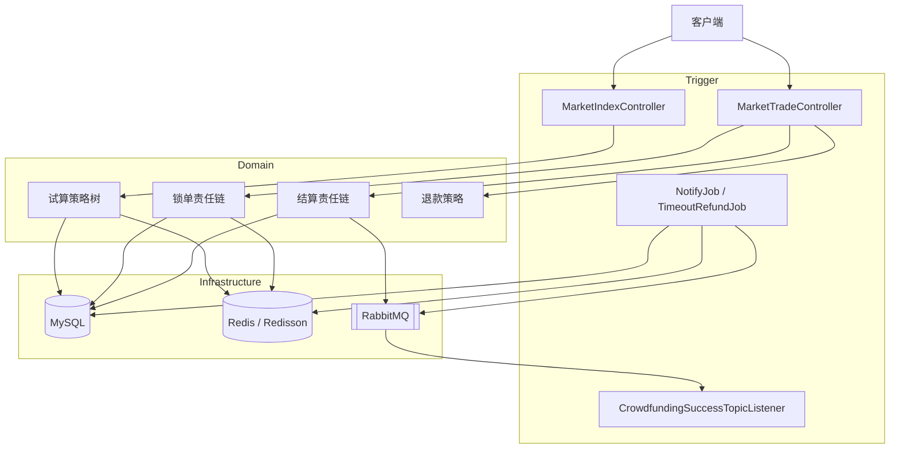

# IndieFund Market

独立游戏众筹的交易中台。用户锁定档位、支付结算、凑满目标后异步通知，超时未支付则退款。工程按 DDD 拆成接口、领域、基础设施和触发器，核心路径是「试算 → 锁单 → 结算 → 成团通知」。

## 架构



请求从 Trigger 进入。领域层只表达规则：试算用策略树，锁单、结算、退款用责任链，不同退款场景再分策略。MySQL 是订单账本，Redis 承担活动缓存、档位库存计数和定时任务互斥，RabbitMQ 负责成团后的异步通知。

## 模块

| 模块 | 职责 |
|---|---|
| `group-buy-market-api` | 对外 DTO 和服务接口 |
| `group-buy-market-types` | 统一响应码、异常 |
| `group-buy-market-domain` | 试算、锁单、结算、退款 |
| `group-buy-market-infrastructure` | MyBatis、Redisson、RabbitMQ、HTTP 回调 |
| `group-buy-market-trigger` | Controller、消息监听、定时任务 |
| `group-buy-market-app` | Spring Boot 启动与线程池配置 |

启动类是 `com.indiefund.market.Application`，默认端口 `8091`，默认 profile 为 `dev`。

## 核心流程

1. 首页试算从 `RootNode` 进入，经开关、人群和营销节点，按折扣类型选择直减 `ZJ`、折扣 `ZK` 或满减 `MJ`。
2. 锁单先查未支付旧单，再走责任链：活动是否可用、用户参与次数、档位库存。通过后写入订单主表和明细。
3. 结算时如果这一单正好凑满目标人数，订单标记完成，并写入通知任务，投递到 `topic.team_success`。
4. `CrowdfundingSuccessTopicListener` 消费成团消息。通知任务也由定时任务扫描补发，多实例之间用 Redisson 锁保证只有一个节点执行。
5. 超时未支付的订单由 `TimeoutRefundJob` 扫描，退款按未支付、已支付、已成团拆成不同策略。

## 技术亮点

### 责任链 + 策略模式

锁单链在 `TradeLockRuleFilterFactory` 里按固定顺序组装：

`ActivityUsabilityRuleFilter` → `UserTakeLimitRuleFilter` → `TeamStockOccupyRuleFilter`

结算链和退款链同样是一节一节往后传。折扣计算则是策略：`MarketNode` 按营销方案从 `ZJ` / `ZK` / `MJ` 三个实现里取一个。新增一种优惠或一种退款，只加一个实现并挂到链上，不用改主流程。

### Redisson：缓存与分布式互斥

活动、折扣走缓存旁路：Redis 没有就读 MySQL，再写回 Redis。档位库存用 Redis 原子计数占用，避免同一团超卖。

`GameCrowdfundingNotifyJob` 和 `TimeoutRefundJob` 用 `RLock` 做任务互斥。多个应用实例同时跑定时任务时，只有抢到锁的实例会发通知或扫超时订单。这里同步的是任务执行权和热数据，不是 Servlet Session。

### 成团后的异步通知

凑满人数的那一次结算不在请求线程里调用所有下游，而是落一条 `notify_task`，再发到交换机 `crowdfunding_hub_exchange`。监听器马上消费；投递失败时任务状态可重试，由通知任务再扫。需要 HTTP 回调时，`GameCrowdfundingNotifyService` 用 OkHttp 发 JSON POST。

### 首页限流与本地短缓存

`POST /api/v1/icf/index/query_group_buy_market_config` 按 `userId` 限流，`permitsPerSecond = 1`。超过阈值走降级方法，不把请求打进试算。Guava 在本仓库里的用途是 `GuavaConfig` 的本地缓存，写入后 3 秒过期，用来挡极短时间内的重复读取。

## 接口

| 方法 | 路径 | 作用 |
|---|---|---|
| POST | `/api/v1/icf/index/query_group_buy_market_config` | 首页试算，带限流 |
| POST | `/api/v1/icf/trade/lock_market_pay_order` | 锁单 |
| POST | `/api/v1/icf/trade/settlement_market_pay_order` | 结算，满员后发消息 |
| POST | `/api/v1/icf/trade/refund_market_pay_order` | 退款 |
| GET | `/api/v1/icf/dcc/update_config` | 动态配置 |

## 本地启动

需要 JDK 8、Maven 3.8+、Docker。

1. 在 `group-buy-market-app/src/main/resources/application-dev.yml` 和根目录 `docker-compose.yml` 里填同一套占位符：`your_mysql_password`、`your_rabbitmq_username`、`your_rabbitmq_password`。
2. 启动中间件。MySQL `3306`，库名 `group_buy_market`；Redis 宿主机 `16379`；RabbitMQ 的 AMQP 映射在宿主机 `15672`，管理台在 `15673`。

```bash
docker compose up -d
```

3. 编译并启动应用。

```bash
mvn -pl group-buy-market-app -am clean package -DskipTests
mvn -pl group-buy-market-app spring-boot:run
```

初始化 SQL 在 `docs/dev-ops/mysql/sql/2-29-group_buy_market.sql`，由 Compose 在第一次创建数据卷时导入。库表名保持原样，和 Java 包名 `com.indiefund.market` 不是同一层东西。

动态配置、责任链框架和限流注解来自 `xfg-wrench` 3.0.0。配置前缀 `xfg.wrench` 是这个依赖的约定，改掉之后组件读不到配置。
